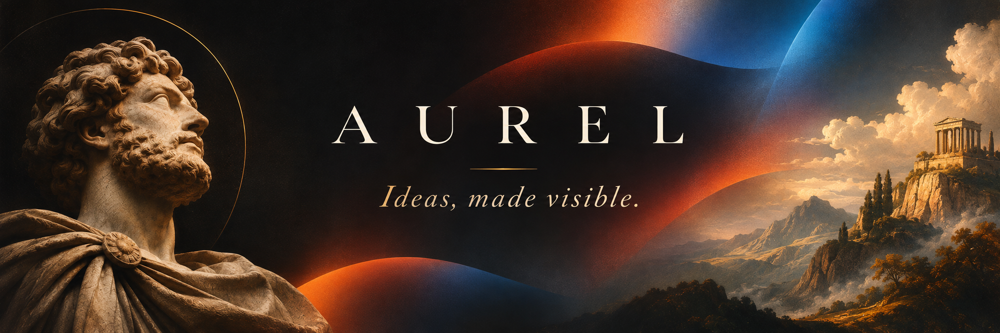

  

# AUREL

**The Generative Art & Philosophy Studio**

> Make meaningful ideas visible through exceptional digital art.

AUREL is an AI-powered creative studio for macOS that turns philosophy, historical artwork, and artistic direction into high-resolution desktop wallpapers — not as prompts dropped on images, but as compositions with creative reasoning behind them.

---

## Product philosophy

Most wallpaper tools offer static libraries, raw AI image generators, or quote-on-template layouts. They rarely combine intellectual depth, art direction, and visual consistency — the qualities that make a wallpaper feel like intentional design rather than decoration.

Take *Memento Mori*. A conventional generator might place a skull beside the words “Remember Death.” AUREL should understand the concept, find relevant historical artwork, interpret its symbolism, select a verified quote, and construct a coherent composition. The difference is the creative system, not the model API underneath.

AUREL is built so that ideas — Stoicism, mortality, ambition, intentional living — become part of the everyday digital environment.

---

## Three pillars

| Pillar | What it means |
|---|---|
| **Intellectual depth** | Philosophy, literature, historical context, and meaningful ideas as first-class product capability |
| **Artistic intelligence** | Creative reasoning across composition, colour, typography, and art curation |
| **Technical excellence** | Procedural graphics, high-resolution rendering, and a premium desktop experience |

Access to an LLM or image model is not the differentiator. The differentiator is how the system understands an idea, chooses a direction, combines visual elements, and produces a finished piece of digital art.

---

## Core experiences

### Generative Expression

Original compositions from a quote, theme, emotional direction, or style — Chromatic Flow, Swiss Editorial, Cinematic Minimalism, and more as creative starting points, not fixed templates.

### Museum Reimagined

Historical artwork from open museum collections, recontextualized with modern typography, colour grading, and editorial layouts — with source artwork remaining identifiable and rights-aware.

### Art Fusion

Classical paintings, sculpture, and landscapes combined with contemporary generative graphics: gradients, experimental form, and cinematic lighting.

---

## Who it’s for

- Design-conscious professionals who want a refined desktop
- Readers of Stoicism, existentialism, Buddhism, and classical philosophy
- Designers, developers, and creative technologists who care about composition as much as generation

---

## Platform

Initial release targets **macOS**, with a local-first creative workflow and architecture designed for a premium commercial product.

---

*AUREL doesn’t merely generate wallpapers. It gives people a new way to experience ideas, philosophy, and art through their everyday digital environment.*
